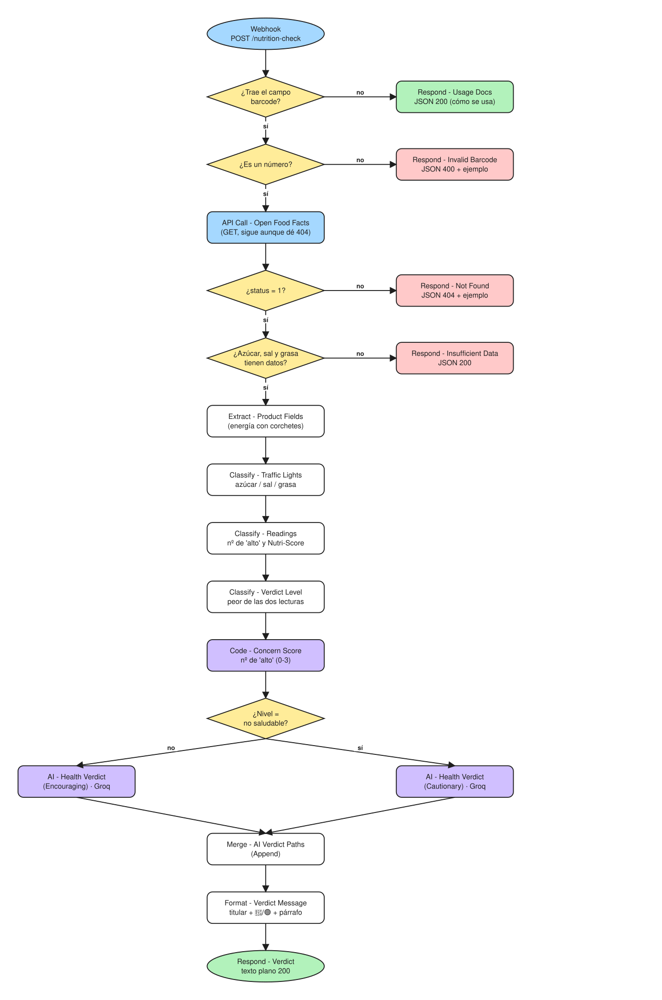

# SnackCheck: Nutrition Check

Flujo de n8n que recibe el código de barras de un alimento envasado y responde, en lenguaje cercano, si es una buena elección para el día a día o mejor un gusto ocasional.



Archivos del proyecto:

| Archivo | Qué es |
|---|---|
| `snackcheck.workflow.json` | El flujo, listo para importar en n8n |
| `diagram.excalidraw` | Diagrama editable (excalidraw.com → Open). `diagram.svg` es la misma figura como imagen |
| `TEST_LOG.md` | Registro de pruebas `TC-XXX` |
| `CHANGELOG.md` | Historial de versiones (SemVer) |
| `tests/verdict-rules.test.js` | Comprueba las reglas de clasificación con las expresiones reales del flujo |

## Propósito

El fundador de la app SnackCheck necesita el "motor" de la app. La app envía un código de barras y el motor devuelve un veredicto corto: un titular, los números clave con marcador 🔴/🟢 y un párrafo amigable escrito por IA. Los datos de nutrición vienen de **Open Food Facts**, una base de datos abierta. No se inventan.

## Cómo funciona

1. **Webhook** `POST /nutrition-check` recibe `{ "barcode": "..." }`.
2. **Validación**:
   - Sin campo `barcode` (o cuerpo vacío): responde con la autodocumentación del servicio.
   - `barcode` vacío o con algo que no sean dígitos: error `400`.
3. **Open Food Facts**: `GET /api/v2/product/{barcode}.json?fields=product_name,brands,nutriscore_grade,nutriments`. El nodo está configurado con *Never Error* para que un `404` no rompa el flujo.
4. **¿Existe?** `status = 1` → sigue. `status = 0` → `404` propio con un código de ejemplo.
5. **¿Tiene datos?** Si falta el azúcar, la sal o la grasa por 100 g, responde "datos insuficientes" y no clasifica.
6. **Extracción**: pasa los campos a variables planas. La energía se lee con corchetes: `nutriments['energy-kcal_100g']`.
7. **Semáforo por 100 g**:
   - Azúcar: `bajo` <5 g, `medio` de 5 a 22.5 g, `alto` >22.5 g.
   - Sal: `alto` >1.5 g.
   - Grasa: `alto` >17.5 g.
8. **Dos lecturas**:
   - Por el número de nutrientes `alto`: 0 = saludable, 1 = moderado, 2-3 = no saludable.
   - Por el Nutri-Score: a/b = saludable, c = moderado, d/e = no saludable.
   
   **El nivel final es la peor de las dos.** Si no hay Nutri-Score (`unknown` o falta), cuenta solo el semáforo.
9. **Puntuación de preocupación** (nodo Code, un solo ítem): cuántos nutrientes salieron `alto`, de 0 a 3. Es informativa: no decide el nivel.
10. **IA (Groq)**: el nodo IF manda `no saludable` al prompt **cauteloso** y `saludable`/`moderado` al **alentador**. Un Merge (Append) junta las dos ramas.
11. **Respuesta**: el veredicto se devuelve como texto plano (`200`).

Mapa de nodos (todos con el formato `[Acción] - [Propósito]` y una nota en el lienzo):

```
Webhook - Nutrition Check Request
└ Validate - Barcode Present ──no──> Respond - Usage Docs (200 JSON)
  └ Validate - Barcode Numeric ──no──> Respond - Invalid Barcode (400 JSON)
    └ API Call - Open Food Facts Product
      └ Check - Product Found ──no──> Respond - Product Not Found (404 JSON)
        └ Check - Nutrient Data Present ──no──> Respond - Insufficient Data (200 JSON)
          └ Extract - Product Fields → Classify - Traffic Lights → Classify - Readings
            → Classify - Verdict Level → Code - Concern Score → Route - Verdict Tone
              ├ sí: AI - Health Verdict (Cautionary)  ← Model - Groq Cautionary
              └ no: AI - Health Verdict (Encouraging) ← Model - Groq Encouraging
                → Merge - AI Verdict Paths → Format - Verdict Message → Respond - Verdict (200 texto)
```

## Configuración

1. En n8n: **⋯ → Import from file** → `snackcheck.workflow.json`.
2. Crea (o elige) una credencial **Groq** con tu clave de console.groq.com y asígnala a los dos nodos `Model - Groq ...`. La clave vive solo en las credenciales de n8n: el JSON exportado no la lleva.
3. Activa (publica) el flujo. No necesita más claves: Open Food Facts es abierta.

Modelo de IA: `openai/gpt-oss-120b` en Groq, temperatura 0.6.

## Uso

```bash
curl -X POST https://<tu-n8n>/webhook/nutrition-check \
  -H "Content-Type: application/json" \
  -d '{"barcode":"3017620422003"}'
```

Respuesta (texto plano):

```
⚠️ Mejor como gusto ocasional Nutella (Ferrero, Nutella)
Veredicto: NO SALUDABLE · Preocupación 2/3

Por 100 g
Azúcar   56.3 g    🔴 alto
Sal      0.107 g   🟢 ok
Grasa    30.9 g    🔴 alto
Energía  539 kcal
Nutri-Score  E

La Nutella de Ferrero contiene 56.3 g de azúcar y 30.9 g de grasa por cada 100 g, ...
```

Códigos para probar:

| Código | Producto | Resultado esperado |
|---|---|---|
| `3017620422003` | Nutella | no saludable (cauteloso) |
| `5449000000996` | Coca-Cola | no saludable: el Nutri-Score E gana al semáforo |
| `8076800195057` | Spaghetti Barilla | saludable (Nutri-Score A, alentador) |
| `3175680011480` | Sésame Gerblé | moderado (alentador) |
| `6111250470209` | Café VIP Gold | datos insuficientes |

## Manejo de errores

| Situación | Código | Tipo | Respuesta |
|---|---|---|---|
| Cuerpo vacío o sin `barcode` | 200 | JSON | Autodocumentación: qué hace, campo requerido, ejemplo |
| `barcode` vacío o no numérico | 400 | JSON | `error: invalid_barcode`, mensaje y ejemplo |
| Producto no está en Open Food Facts | 404 | JSON | `error: product_not_found`, mensaje y ejemplo válido |
| Producto sin azúcar/sal/grasa | 200 | JSON | `status: insufficient_data` |
| Veredicto | 200 | texto plano | Titular, números con 🔴/🟢, párrafo de IA |

El nodo HTTP también tiene *On Error → Continue*: si Open Food Facts se cae o no responde en 15 s, el flujo no se rompe y la persona recibe la respuesta de "no encontrado".

## Limitaciones

- Si Open Food Facts está caído, la respuesta es "no encontrado" en vez de un error de servicio específico.
- Para clasificar se exigen los tres nutrientes (azúcar, sal y grasa). Si falta uno solo, la respuesta es "datos insuficientes".
- Las bebidas se miden por 100 ml, pero se comparan con umbrales pensados para 100 g. Por eso el Nutri-Score pesa tanto en el veredicto.
- El código de barras solo se valida como "solo dígitos": no se comprueba la longitud ni el dígito de control.
- El párrafo de IA puede variar entre ejecuciones y depende de que Groq esté disponible. Si Groq falla, el flujo falla en ese paso.
- Un producto, una petición: no hay consultas por lotes ni caché.
